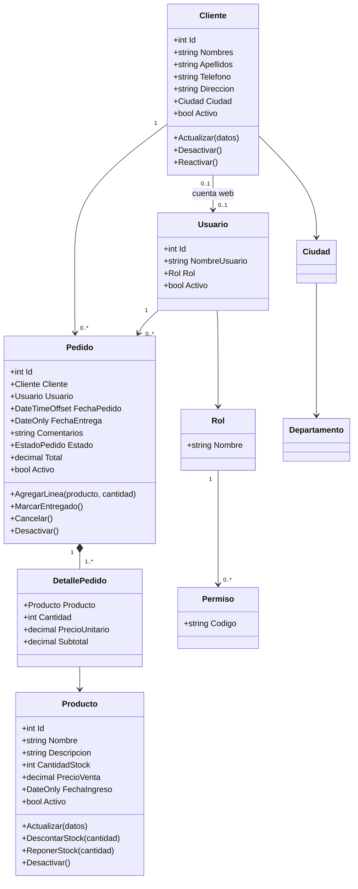
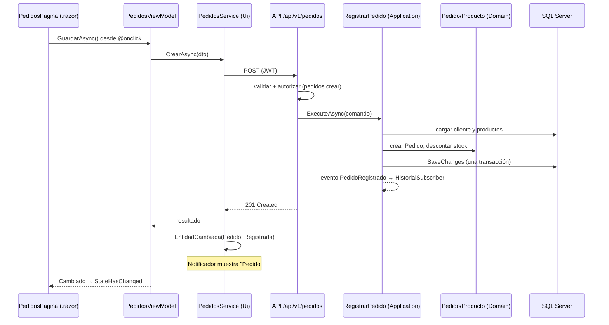

# 📐 Diseño Arquitectónico - Gestión de Pedidos (UFG)

## 1. Vista General

**Una sola interfaz (Blazor) con dos hospedajes** —un **escritorio .NET MAUI Blazor Hybrid** y una **web Blazor Web App**— que consumen **una misma API ASP.NET Core** organizada en capas (**Clean Architecture**), que persiste en **SQL Server** con EF Core. Todas las pantallas (administración y tienda) viven en una **biblioteca de componentes Razor** (`GestionPedidos.Ui`) y se escriben una sola vez.

```
┌──────────────────────────┐        ┌───────────────────────────┐
│ Desktop                  │        │ Web                       │
│ .NET MAUI Blazor Hybrid  │        │ Blazor Web App            │
│ (Windows, .exe)          │        │ (Docker, navegador)       │
└────────────┬─────────────┘        └─────────────┬─────────────┘
             └──────────────┬─────────────────────┘
                            ▼
        ┌───────────────────────────────────────────┐
        │ GestionPedidos.Ui  (Razor Class Library)  │
        │  Páginas (.razor)  ◄─ eventos ─►  ViewModels│
        │  Servicios de módulo (publicadoras)       │
        │  ApiClient (HttpClient tipado, JWT)       │
        └─────────────────────┬─────────────────────┘
                              │ HTTP / JSON
┌─────────────────────────────▼─────────────────────────────┐
│  API (ASP.NET Core)                                        │
│  Endpoints por módulo · validación · JWT · permisos ·      │
│  Problem Details · rate limiting                           │
├────────────────────────────────────────────────────────────┤
│  Application   casos de uso · puertos · eventos            │
│                suscriptores: Historial de actividades      │
├────────────────────────────────────────────────────────────┤
│  Domain        entidades · reglas · invariantes (sin deps) │
├────────────────────────────────────────────────────────────┤
│  Infrastructure  EF Core · DbContext · migraciones · SQL   │
└─────────────────────────────┬──────────────────────────────┘
                              ▼
                     SQL Server 2022 (Docker)
```

### 1.1 Qué cambia entre los dos hospedajes

| Aspecto | Desktop (MAUI Hybrid) | Web (Blazor Web App) |
|---|---|---|
| Dónde corren los componentes | En el equipo del usuario, dentro de un `BlazorWebView` | En el servidor (render interactivo de servidor), el navegador recibe HTML |
| Área que se abre | **Administración** (requiere `admin.acceso`) | **Tienda pública**; el personal también puede entrar a Administración |
| Almacén de sesión (`ISesionAlmacen`) | Memoria del proceso | `ProtectedSessionStorage` (cifrado, sobrevive a F5, se borra al cerrar la pestaña) |
| Cómo llama a la API | `HttpClient` a la URL de `appsettings.json` | `HttpClient` desde el servidor web por la red de Docker |

Los componentes **no** usan nada exclusivo de un hospedaje (`HttpContext`, APIs de MAUI…): lo específico entra por interfaces (`ISesionAlmacen`) registradas en cada `Program`/`MauiProgram`.

## 2. Regla de Dependencias

```
Domain  ◄──  Application  ◄──  Api
                  ▲             │
                  └─ Infrastructure (implementa los puertos; la Api la registra)

Contracts (DTOs): referenciado por Application, Api y Ui; nunca por Domain
Ui (RCL): depende solo de Contracts
Web y Desktop (hospedajes): dependen solo de Ui y Contracts
```

* `Domain` no referencia ningún proyecto ni paquete de infraestructura.
* `Application` referencia `Domain` y `Contracts` (los DTOs son su entrada y salida, así no se duplican modelos); declara los puertos (`IClienteRepository`, `IUnitOfWork`…); el tiempo se inyecta con `TimeProvider`.
* `Infrastructure` implementa los puertos y es la **única** que referencia EF Core.
* `Api` es la raíz de composición de la API.
* `Ui`, `Web` y `Desktop` **no** conocen el dominio del servidor: usan los DTOs de `Contracts` y hablan solo con la API.
* Las reglas se verifican con pruebas de arquitectura ([Testing.md](Especificaciones/Testing.md)).

## 3. Modelo de Dominio



* `Pedido` es **raíz de agregado**: las líneas solo se modifican a través de él, y él protege sus invariantes (no entregar un pedido cancelado, no quedarse sin líneas…).
* Importes con `decimal`; el precio unitario se **copia** a la línea al crear el pedido.
* El **stock** lo modifican `Producto.DescontarStock/ReponerStock`, que rechazan resultados negativos.

## 4. Eventos: Dónde Viven y Quién Reacciona

El mecanismo es el de la materia: **delegados + `event` + `EventArgs`** ([PatronEventos.md](Especificaciones/PatronEventos.md)). Cuatro niveles, cada uno en su capa:

| Nivel | Publicadora | Suscriptores | Para qué |
|---|---|---|---|
| **Eventos de interfaz** (Blazor) | Elementos HTML y componentes (`@onclick`, `@onchange`, `EventCallback<T>`) | La página que los contiene | Responder a la acción del usuario |
| **Eventos del ViewModel** | `<Modulo>ViewModel` (`event EventHandler Cambiado`) | La página (`+=` en `OnInitialized`, `-=` en `Dispose`) | Avisar a la página de que su estado cambió para repintarla |
| **Notificaciones de cliente** | Servicios de módulo (`ClientesService`…), **tras** confirmar la API | `Notificador` (aviso en pantalla) y ViewModels abiertos que refrescan su listado | "Notificar el ingreso, actualización o cambio de estado" (RF-03/04/05) |
| **Eventos de aplicación** (servidor) | Casos de uso, **tras** confirmar la transacción | `HistorialSubscriber` (escribe en `Actividades`) | Historial de actividades (RF-10) |

```
Usuario ─@onclick─► Página ─► ViewModel ─► ClientesService ─► API
                                               │ (éxito)
                             EntidadCambiada ◄─┘
                              │              │
                       Notificador     ClientesViewModel (refresca el listado → Cambiado → Página)
```

Reglas clave ([PautasCodigoEventos.md](Equipo/PautasCodigoEventos.md)):
1. Un evento se dispara **solo después de que la operación fue confirmada**.
2. Quien se suscribe con `+=` se da de baja con `-=` (en Blazor, `IDisposable.Dispose` del componente).
3. En Blazor, un evento que llega fuera del ciclo de render se atiende con `await InvokeAsync(StateHasChanged)`.
4. Los eventos no cruzan procesos: el servidor no notifica a otros clientes (sin SignalR, YAGNI).

## 5. Flujo Completo: Registrar un Pedido



Si el stock no alcanza: la API responde `422` con el detalle, el servicio dispara `StockInsuficiente` y el notificador avisa; **no** se modifica nada.

## 6. Estrategia de API

* Versionada por ruta (`/api/v1/...`), orientada a recursos, en español para los recursos de negocio (`clientes`, `productos`, `pedidos`).
* Errores con **Problem Details (RFC 9457)**: `400` entrada inválida, `401` sin sesión, `403` sin permiso, `404`, `409` conflicto de concurrencia, `422` regla de negocio.
* Listados **paginados** (`pagina`, `tamanoPagina`, tope 100) con filtros por *query string* ([Busquedas.md](Especificaciones/Busquedas.md)).
* Autorización por **permisos** en cada endpoint, no solo por rol ([AutenticacionYPermisos.md](Especificaciones/AutenticacionYPermisos.md)).
* OpenAPI/UI de pruebas solo en `Development`.
* `GET /health` y `GET /health/ready` para Docker y Dokploy.

## 7. Estrategia de la Interfaz (Ui)

* **Página + ViewModel**: el `.razor` solo contiene marcado y enlaza eventos; el estado y la lógica de interfaz viven en un `ViewModel` (clase C# normal) que se prueba **sin navegador ni pantalla**.
* **Un solo shell** (`MainLayout`): barra superior, menú por permisos y **pestañas de documentos** abiertos (interfaz de múltiples documentos, [InterfazUsuario.md §2](Especificaciones/InterfazUsuario.md)).
* **Nunca bloquear la interfaz**: llamadas con `async/await`, indicador de carga y cancelación.
* **Sesión**: JWT en memoria o en `ProtectedSessionStorage` según el hospedaje ([§1.1](#11-qué-cambia-entre-los-dos-hospedajes)).
* Configuración (URL de la API) en `appsettings.json` del hospedaje, sin secretos.
* **Endpoints públicos y de cliente** (`catalogo`, `auth/registro`, `mis-pedidos`, `mi-perfil`) con *rate limiting*; los de cliente filtran siempre por el cliente del token ([PortalWeb.md §4](Especificaciones/PortalWeb.md)).
