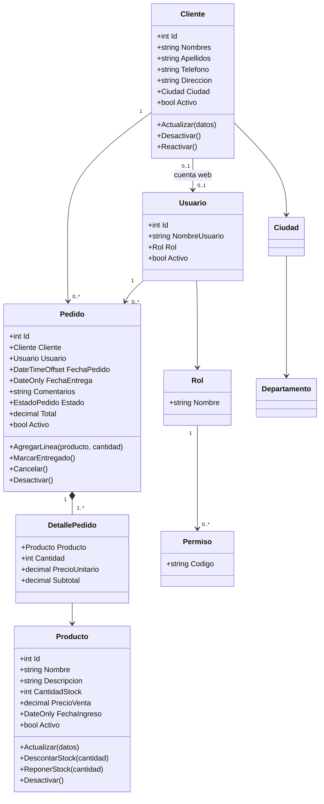
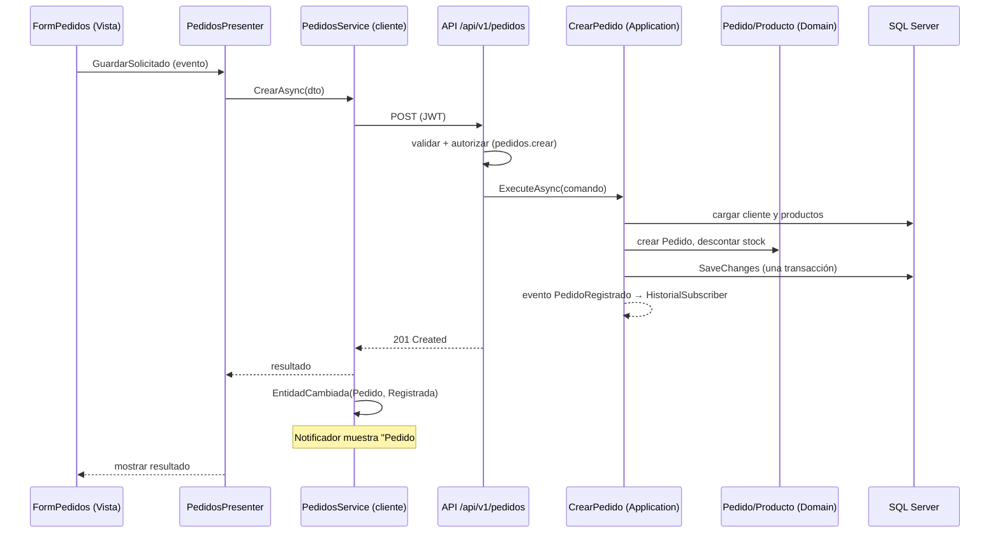

# 📐 Diseño Arquitectónico - Gestión de Pedidos (UFG)

## 1. Vista General

Dos clientes —un **escritorio Windows Forms (MDI)** para la administración y una **web Blazor Web App** para el público— que hablan por HTTP con **una misma API ASP.NET Core** organizada en capas (**Clean Architecture**), que persiste en **SQL Server** con EF Core. El diagrama detalla el escritorio; la web está en §1.1.

```
┌──────────────────────────────────────────────────────────────┐
│  Cliente de escritorio  (Windows Forms, MDI)  — en Windows   │
│                                                              │
│  Vistas (Forms)  ◄── eventos ──►  Presentadores               │
│                                        │                     │
│                          Servicios de cliente (publicadoras) │
│                          │  eventos: EntidadCambiada, ...    │
│                          ▼                                   │
│                   ApiClient (HttpClient tipado, JWT)         │
└──────────────────────────┬───────────────────────────────────┘
                           │ HTTPS / JSON
┌──────────────────────────▼───────────────────────────────────┐
│  API (ASP.NET Core)                                          │
│  Endpoints por módulo · validación · autenticación JWT ·     │
│  autorización por permisos · Problem Details                 │
├──────────────────────────────────────────────────────────────┤
│  Application   casos de uso · puertos · eventos (publicadoras)│
│                suscriptores: Historial de actividades        │
├──────────────────────────────────────────────────────────────┤
│  Domain        entidades · reglas · invariantes (sin deps)   │
├──────────────────────────────────────────────────────────────┤
│  Infrastructure  EF Core · DbContext · migraciones · SQL     │
└──────────────────────────┬───────────────────────────────────┘
                           ▼
                  SQL Server 2022 (Docker)
```

### 1.1 Cliente web

```
 Navegador ──HTTPS──► Web (Blazor Web App, render de servidor) ──HTTP, JWT en el servidor──► API ──► SQL Server
```

* La web llama a la API desde su **servidor** y entrega al navegador solo una cookie de sesión: no hay token en el navegador ni CORS ([PortalWeb.md §5](Especificaciones/PortalWeb.md)).
* Reutiliza las mismas reglas de negocio: un pedido hecho en la web es un `Pedido` más.

## 2. Regla de Dependencias

```
Domain  ◄──  Application  ◄──  Api
                  ▲             │
                  └─ Infrastructure (implementa los puertos; la Api la registra)

Contracts (DTOs): referenciado por Api, Desktop y Web; nunca por Domain
Desktop y Web: dependen solo de Contracts (hablan con la API, nunca con Domain/Infrastructure)
```

* `Domain` no referencia ningún proyecto ni paquete de infraestructura.
* `Application` referencia solo `Domain`; declara los puertos (`IClienteRepository`, `IUnitOfWork`…); el tiempo se inyecta con `TimeProvider`.
* `Infrastructure` implementa los puertos y es la **única** que referencia EF Core.
* `Api` es la raíz de composición de la API.
* `Desktop` y `Web` **no** conocen el dominio del servidor: usan los DTOs de `Contracts`.
* Las reglas se verifican con pruebas de arquitectura ([Testing.md](Especificaciones/Testing.md)).

## 3. Modelo de Dominio



* `Pedido` es **raíz de agregado**: las líneas solo se modifican a través de él, y él protege sus invariantes (no entregar un pedido cancelado, no quedarse sin líneas…).
* Importes con `decimal`; el precio unitario se **copia** a la línea al crear el pedido.
* El **stock** lo modifican `Producto.DescontarStock/ReponerStock`, que rechazan resultados negativos.

## 4. Eventos: Dónde Viven y Quién Reacciona

El mecanismo es el de la materia: **delegados + `event` + `EventArgs`** ([PatronEventos.md](Especificaciones/PatronEventos.md)). Hay **cuatro niveles** de eventos, cada uno en su capa:

| Grupo | Publicadora | Suscriptores | Para qué |
|---|---|---|---|
| **Eventos de interfaz** (controles WinForms) | Cada control (`Button.Click`, `ComboBox.SelectedIndexChanged`…) | La vista que los contiene, que los reexpone al presentador | Responder a la acción del usuario |
| **Eventos de la vista** (propios) | La vista (`event EventHandler GuardarSolicitado`) | El presentador (`+=`) | Presentador sin depender de controles |
| **Notificaciones de cliente** | Servicios de cliente (`ClientesService`…), **tras** confirmar la API | `Notificador` (barra de estado) y ventanas abiertas que refrescan su listado | "Notificar el ingreso, actualización o cambio de estado" (RF-03/04/05) |
| **Eventos de aplicación** (servidor) | Casos de uso, **tras** confirmar la transacción | `HistorialSubscriber` (escribe en `Actividades`) | Historial de actividades (RF-10) |

```
Usuario ─Click─► Form ─GuardarSolicitado─► Presenter ─► ClientesService ─► API
                                                            │ (éxito)
                                          EntidadCambiada ◄─┘
                                           │              │
                                    Notificador      FormClientes (refresca grid)
```

Reglas clave (detalle en [PautasCodigoEventos.md](Equipo/PautasCodigoEventos.md)):
1. Un evento se dispara **solo después de que la operación fue confirmada** (respuesta exitosa de la API / transacción guardada).
2. Quien se suscribe con `+=` se da de baja con `-=` al destruirse (evita fugas y llamadas a formularios cerrados).
3. Los eventos no cruzan procesos: el servidor no notifica a otros clientes (sin SignalR, YAGNI).

## 5. Flujo Completo: Registrar un Pedido



Si el stock no alcanza: la API responde `422` con el detalle, el servicio de cliente dispara `StockInsuficiente` y el notificador avisa; **no** se modifica nada.

## 6. Estrategia de API

* Versionada por ruta (`/api/v1/...`), orientada a recursos, en español para los recursos de negocio (`clientes`, `productos`, `pedidos`).
* Errores con **Problem Details (RFC 9457)**: `400` entrada inválida, `401` sin sesión, `403` sin permiso, `404`, `409` conflicto de concurrencia, `422` regla de negocio.
* Listados **paginados** (`pagina`, `tamanoPagina`, tope 100) con filtros por *query string* ([Busquedas.md](Especificaciones/Busquedas.md)).
* Autorización por **permisos** en cada endpoint, no solo por rol ([AutenticacionYPermisos.md](Especificaciones/AutenticacionYPermisos.md)).
* OpenAPI/UI de pruebas solo en `Development`.
* `GET /health` y `GET /health/ready` para Docker y Dokploy.

## 7. Estrategia del Cliente de Escritorio

* **MDI**: `MainForm` es el contenedor; cada módulo es un formulario hijo con una sola instancia abierta ([InterfazEscritorio.md](Especificaciones/InterfazEscritorio.md)).
* **MVP pasivo**: la vista solo muestra datos y expone eventos; el presentador decide. Los presentadores se prueban sin interfaz.
* **Nunca bloquear el hilo de la interfaz**: llamadas a la API con `async/await`, indicador de carga y cancelación.
* **Sesión en memoria**: el token no se guarda en disco; al cerrar la aplicación se cierra la sesión ([Seguridad.md §4](Seguridad.md)).
* Configuración (URL de la API) en `appsettings.json` junto al ejecutable, sin secretos.
* **Endpoints públicos y de cliente** (`catalogo`, `auth/registro`, `mis-pedidos`, `mi-perfil`) con *rate limiting*; los de cliente filtran siempre por el cliente del token ([PortalWeb.md §4](Especificaciones/PortalWeb.md)).
