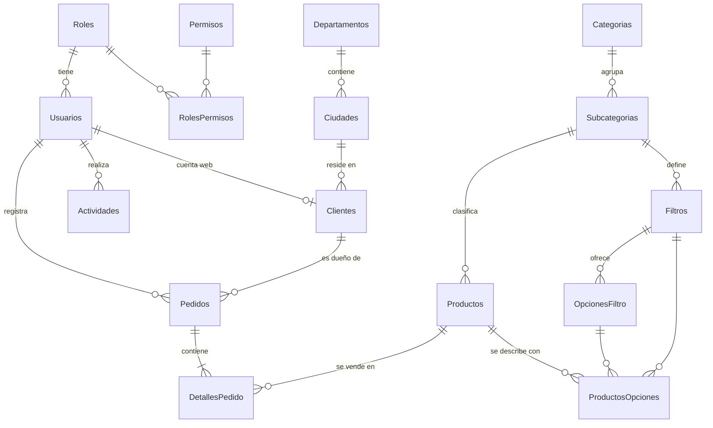

# 🗄️ Base de Datos - Gestión de Pedidos (UFG)

> Modelo derivado de los requerimientos oficiales ([Analisis.md](Analisis.md)). Las interpretaciones del enunciado están en [Analisis.md §3](Analisis.md).

## 1. Motor y Enfoque

* **SQL Server 2022** (edición Developer en desarrollo) en contenedor, con volumen nombrado.
* **Code-first con Entity Framework Core**: el esquema se define con `IEntityTypeConfiguration<T>` y se versiona con **migraciones**. Nadie modifica la BD a mano.
* Nombre de la base: `GestionPedidos`.
* La aplicación **no usa `sa`** (ver §7).
* **Consultas parametrizadas siempre** (criterio de la rúbrica): EF Core genera `sp_executesql` con parámetros; prohibido concatenar texto en SQL. Además, la búsqueda de pedidos usa un **procedimiento almacenado** (§6) para cubrir también esa opción de la rúbrica.

## 2. Diagrama Entidad-Relación

## 3. Convenciones de Esquema

| Tema | Convención |
|---|---|
| Esquema | `dbo` |
| Tablas | Plural en español, `PascalCase` (`Clientes`, `DetallesPedido`) |
| Clave primaria | `Id INT IDENTITY(1,1)` (`BIGINT` en `Actividades`). Se elige entero y no `Guid` por simplicidad (KISS): números legibles en pantalla ("Pedido #1042"), índices más pequeños y sin fragmentación |
| Claves foráneas | `<Entidad>Id` (`ClienteId`, `RolId`) con índice |
| Dinero | `DECIMAL(18,2)` explícito (nunca `float`) |
| Texto | `NVARCHAR(n)` con longitud explícita; sin `NVARCHAR(MAX)` |
| Fechas/hora | `DATETIMEOFFSET(0)` en **UTC** para marcas de tiempo (`CreadoEn`…); `DATE` para fechas de negocio (`FechaEntrega`, `FechaIngreso`). La conversión a hora local es solo de presentación |
| Baja lógica | Columna `Activo BIT NOT NULL DEFAULT 1` en `Clientes`, `Productos`, `Pedidos`, `Usuarios` ("eliminar = pasar a inactivo", requisito del enunciado). Además `EliminadoEn DATETIMEOFFSET(0) NULL` (fecha de la baja; se limpia al reactivar). `DELETE` físico solo de **usuarios** ya dados de baja y sin pedidos, y de elementos inactivos y sin uso del catálogo de clasificación ([§4.7](#47-clasificación-del-catálogo-de-productos-extensión)); clientes, productos y pedidos no se borran |
| Auditoría ligera | `CreadoEn` y `ActualizadoEn` (UTC) en las tablas principales, mantenidas por el `DbContext` |
| Concurrencia | `RowVersion ROWVERSION` en `Clientes`, `Productos`, `Pedidos`, `Usuarios` |
| Enumeraciones | `NVARCHAR` legible con `CHECK` (no enteros "mágicos") |
| Restricciones | `FK`, `UNIQUE`, `CHECK` en BD **además** de las reglas del dominio |

## 4. Tablas

> Tipos y restricciones son la **especificación**; las migraciones deben reproducirlas.

### 4.1 Seguridad

**`Roles`**

| Columna | Tipo | Restricciones |
|---|---|---|
| Id | INT IDENTITY | PK |
| Nombre | NVARCHAR(50) | NOT NULL, UNIQUE |
| Descripcion | NVARCHAR(200) | NULL |

Datos iniciales: `Administrador`, `Operador` (escritorio) y `Cliente` (web pública).

**`Permisos`**

| Columna | Tipo | Restricciones |
|---|---|---|
| Id | INT IDENTITY | PK |
| Codigo | NVARCHAR(60) | NOT NULL, UNIQUE (ej. `clientes.crear`) |
| Descripcion | NVARCHAR(200) | NOT NULL |

**`RolesPermisos`**: `RolId` (FK) + `PermisoId` (FK), PK compuesta. Catálogo y matriz en [AutenticacionYPermisos.md §3](Especificaciones/AutenticacionYPermisos.md).

**`Usuarios`**

| Columna | Tipo | Restricciones |
|---|---|---|
| Id | INT IDENTITY | PK |
| NombreUsuario | NVARCHAR(150) | NOT NULL, UNIQUE (en el registro web es el correo) |
| NombreCompleto | NVARCHAR(150) | NOT NULL |
| Correo | NVARCHAR(150) | NOT NULL, UNIQUE |
| ClaveHash | NVARCHAR(255) | NOT NULL (nunca la clave en claro) |
| RolId | INT | NOT NULL, FK → Roles (un usuario tiene **un** rol) |
| Activo | BIT | NOT NULL, DEFAULT 1 |
| DebeCambiarClave | BIT | NOT NULL, DEFAULT 0 (1 para el administrador inicial) |
| IntentosFallidos | INT | NOT NULL, DEFAULT 0 |
| BloqueadoHasta | DATETIMEOFFSET(0) | NULL |
| UltimoAcceso | DATETIMEOFFSET(0) | NULL |
| CreadoEn / ActualizadoEn | DATETIMEOFFSET(0) | NOT NULL |
| RowVersion | ROWVERSION | |

### 4.2 Catálogos geográficos

**`Departamentos`**: `Id`, `Codigo NVARCHAR(3)` UNIQUE (código ISO 3166-2, ej. `SS`), `Nombre NVARCHAR(60)` UNIQUE. Datos iniciales: los **14 departamentos** de El Salvador.

**`Ciudades`**: `Id`, `DepartamentoId` FK, `Municipio NVARCHAR(80)`, `Nombre NVARCHAR(80)`, UNIQUE (`DepartamentoId`, `Nombre`) — el índice único sirve a la consulta "ciudades de un departamento".

> **Ciudad = distrito municipal.** Se cargan los **262 distritos** de El Salvador (los antiguos municipios) como "ciudades". `Municipio` guarda el municipio vigente (uno de los **44** creados en 2024) al que pertenece cada distrito, para mostrar la dirección completa ("Atiquizaya, Ahuachapán Norte, Ahuachapán"). El cliente guarda solo `CiudadId`; el departamento se deduce de la ciudad (sin redundancia) y la interfaz usa listas dependientes.
>
> **Origen de los datos**: archivo fijo `seed/el-salvador-geo.json`, **ya incluido en el repositorio**, construido a partir del listado de la Ley Especial para la Reestructuración Municipal (14 departamentos, 44 municipios, 262 distritos; los conteos por departamento están verificados). La semilla lo carga; la aplicación no consulta ningún servicio externo.
>
> **Rendimiento con un catálogo grande**: las ciudades **nunca se piden todas a la vez**: `GET /api/v1/departamentos/{id}/ciudades` filtra por departamento (como máximo 33 filas) y admite búsqueda por nombre; al ser un catálogo casi inmutable se cachea en memoria en la API. Usa el índice único `(DepartamentoId, Nombre)`.

### 4.3 Clientes

**`Clientes`**

| Columna | Tipo | Restricciones |
|---|---|---|
| Id | INT IDENTITY | PK |
| Nombres | NVARCHAR(100) | NOT NULL |
| Apellidos | NVARCHAR(100) | NOT NULL |
| Telefono | NVARCHAR(20) | NOT NULL |
| Direccion | NVARCHAR(250) | NOT NULL |
| Correo | NVARCHAR(150) | NULL, **único cuando no es nulo** (índice filtrado). Opcional: el enunciado no lo pide; sirve para enlazar al cliente con su cuenta de la web |
| CiudadId | INT | NOT NULL, FK → Ciudades |
| UsuarioId | INT | NULL, FK → Usuarios; **único cuando no es nulo** (índice filtrado). Enlaza al cliente con su cuenta de la web pública; es nulo en los clientes registrados por un operador |
| Activo | BIT | NOT NULL, DEFAULT 1 |
| CreadoEn / ActualizadoEn | DATETIMEOFFSET(0) | NOT NULL |
| RowVersion | ROWVERSION | |

Índices: `(Apellidos, Nombres)`, `CiudadId`, `Activo` y los índices únicos filtrados de `UsuarioId` y `Correo`. Teléfono con formato validado en la aplicación (no se fuerza único: una familia puede compartir teléfono).

### 4.4 Productos

**`Productos`**

| Columna | Tipo | Restricciones |
|---|---|---|
| Id | INT IDENTITY | PK |
| Nombre | NVARCHAR(150) | NOT NULL |
| Descripcion | NVARCHAR(500) | NOT NULL |
| CantidadStock | INT | NOT NULL, `CHECK (CantidadStock >= 0)` |
| PrecioVenta | DECIMAL(18,2) | NOT NULL, `CHECK (PrecioVenta >= 0)` |
| SubcategoriaId | INT | NULL, FK → Subcategorias (**clasificación opcional**, [§4.7](#47-clasificación-del-catálogo-de-productos-extensión)); NULL = "Sin clasificar" |
| MostrarStock | BIT | NOT NULL, DEFAULT 0. Si es 1, la tienda web muestra la cantidad exacta; si es 0, solo "Disponible" o "Agotado" |
| FechaIngreso | DATE | NOT NULL, DEFAULT fecha actual |
| Activo | BIT | NOT NULL, DEFAULT 1 |
| CreadoEn / ActualizadoEn | DATETIMEOFFSET(0) | NOT NULL |
| RowVersion | ROWVERSION | |

> **Interpretación**: el campo "Fecha" del producto se toma como **fecha de ingreso al inventario**.

Índices: `Nombre`, `PrecioVenta`, `Activo`, `SubcategoriaId`.

### 4.5 Pedidos

**`Pedidos`** (cabecera)

| Columna | Tipo | Restricciones |
|---|---|---|
| Id | INT IDENTITY | PK (número de pedido) |
| ClienteId | INT | NOT NULL, FK → Clientes (**dueño del pedido**) |
| UsuarioId | INT | NOT NULL, FK → Usuarios (**quién hizo el pedido**: el operador o administrador que lo registró, o el propio cliente si lo hizo desde la web) |
| FechaPedido | DATETIMEOFFSET(0) | NOT NULL, asignada por el sistema |
| FechaEntrega | DATE | NOT NULL (fecha de entrega prevista) |
| Comentarios | NVARCHAR(500) | NULL |
| Estado | NVARCHAR(20) | NOT NULL, `CHECK (Estado IN ('Pendiente','Entregado','Cancelado'))`, DEFAULT `Pendiente` |
| Total | DECIMAL(18,2) | NOT NULL, `CHECK (Total >= 0)` |
| Activo | BIT | NOT NULL, DEFAULT 1 (baja lógica) |
| CreadoEn / ActualizadoEn | DATETIMEOFFSET(0) | NOT NULL |
| RowVersion | ROWVERSION | |

**`DetallesPedido`** (líneas)

| Columna | Tipo | Restricciones |
|---|---|---|
| Id | INT IDENTITY | PK |
| PedidoId | INT | NOT NULL, FK → Pedidos |
| ProductoId | INT | NOT NULL, FK → Productos |
| Cantidad | INT | NOT NULL, `CHECK (Cantidad > 0)` |
| PrecioUnitario | DECIMAL(18,2) | NOT NULL, `CHECK (PrecioUnitario >= 0)` |
| Subtotal | calculada persistida | `Cantidad * PrecioUnitario` |
| — | — | UNIQUE (`PedidoId`, `ProductoId`): un producto aparece una sola vez por pedido (se suman cantidades) |

> **Interpretación**: el enunciado lista en "pedidos" a la vez *producto* y *precio por unidad*. Se modela un pedido con **una o varias líneas**: cada línea guarda producto, cantidad y **precio por unidad copiado en el momento del pedido** (un cambio posterior del precio del producto no altera pedidos históricos). Un pedido de un solo producto cumple igualmente el enunciado.

Índices: `Pedidos(ClienteId)`, `Pedidos(UsuarioId)`, `Pedidos(Estado, FechaPedido)`, `Pedidos(FechaEntrega)`, `DetallesPedido(ProductoId)`.

### 4.6 Historial de actividades (opcional en el enunciado, incluido)

**`Actividades`**

| Columna | Tipo | Restricciones |
|---|---|---|
| Id | BIGINT IDENTITY | PK |
| UsuarioId | INT | NULL, FK → Usuarios (NULL en intentos de login con usuario inexistente) |
| Fecha | DATETIMEOFFSET(0) | NOT NULL |
| Accion | NVARCHAR(40) | NOT NULL (`Registrar`, `Actualizar`, `CambiarEstado`, `Login`, `LoginFallido`…) |
| Entidad | NVARCHAR(40) | NOT NULL (`Cliente`, `Producto`, `Pedido`, `Usuario`…) |
| EntidadId | INT | NULL |
| Detalle | NVARCHAR(500) | NULL (nunca contraseñas ni tokens) |

Índices: `Fecha`, `UsuarioId`. El usuario de la aplicación solo tiene `INSERT` y `SELECT` sobre esta tabla (registro **inalterable**, §7).

### 4.7 Clasificación del catálogo de productos (extensión)

> Versión **básica** de un motor de catálogo dinámico: sin SKU, variantes, costo ni imágenes ([CatalogoProductos.md §2](Especificaciones/CatalogoProductos.md)). Todas las tablas siguen las convenciones de §3 (`Id INT IDENTITY`, `CreadoEn`/`ActualizadoEn`, `RowVersion`) y la baja suave `Activo` + `EliminadoEn`.

**`Categorias`**

| Columna | Tipo | Restricciones |
|---|---|---|
| Id | INT IDENTITY | PK |
| Nombre | NVARCHAR(100) | NOT NULL, **UNIQUE** (se compara también con las inactivas, para poder reactivar sin duplicados) |
| Descripcion | NVARCHAR(300) | NULL |
| Activo / EliminadoEn | BIT / DATETIMEOFFSET(0) | NOT NULL DEFAULT 1 / NULL |

**`Subcategorias`**: `Id`, `CategoriaId` (FK → Categorias, `NO ACTION`), `Nombre` NVARCHAR(100), `Descripcion` NVARCHAR(300) NULL, `Activo`, `EliminadoEn`. **UNIQUE (`CategoriaId`, `Nombre`)**.

**`Filtros`**: `Id`, `SubcategoriaId` (FK → Subcategorias), `Nombre` NVARCHAR(100), `Activo`, `EliminadoEn`. **UNIQUE (`SubcategoriaId`, `Nombre`)**.

**`OpcionesFiltro`**: `Id`, `FiltroId` (FK → Filtros), `Valor` NVARCHAR(100), `Activo`, `EliminadoEn`. **UNIQUE (`FiltroId`, `Valor`)** y **UNIQUE (`Id`, `FiltroId`)** (necesario para la FK compuesta de abajo).

**`ProductosOpciones`** (el *detalle del producto*)

| Columna | Tipo | Restricciones |
|---|---|---|
| ProductoId | INT | NOT NULL, FK → Productos |
| FiltroId | INT | NOT NULL, FK → Filtros |
| OpcionFiltroId | INT | NOT NULL |
| — | — | **PK (`ProductoId`, `FiltroId`)**: una sola opción por filtro y producto |
| — | — | **FK compuesta (`OpcionFiltroId`, `FiltroId`) → `OpcionesFiltro (Id, FiltroId)`**: la opción tiene que ser **del filtro indicado** |

> Que el filtro pertenezca a la **subcategoría del producto** lo valida la aplicación (la base no puede expresarlo sin duplicar datos). Al cambiar la subcategoría de un producto se borran sus filas de `ProductosOpciones`.

Índices: `Subcategorias(CategoriaId)`, `Filtros(SubcategoriaId)`, `OpcionesFiltro(FiltroId)`, `ProductosOpciones(OpcionFiltroId)` (para filtrar la tienda por opción), `Productos(SubcategoriaId)`.

## 5. Reglas de Integridad que Cruzan Tablas

* Un producto solo puede tener **opciones de los filtros de su subcategoría**, una por filtro ([§4.7](#47-clasificación-del-catálogo-de-productos-extensión)).
* El **stock nunca es negativo** (`CHECK` + reglas del dominio + concurrencia optimista).
* Crear un pedido descuenta existencias en la **misma transacción**; cancelar o dar de baja un pedido `Pendiente` las devuelve ([Pedidos.md §3](Especificaciones/Pedidos.md)).
* No se da de baja un cliente con pedidos `Pendiente`.
* Dar de baja un producto no altera las líneas históricas.

## 6. Procedimientos Almacenados y Vistas

Solo de **lectura**, para no esconder reglas de negocio fuera del código ni de los eventos:

| Objeto | Uso |
|---|---|
| `usp_Pedidos_Buscar` | Búsqueda de pedidos con todos los filtros de [Busquedas.md](Especificaciones/Busquedas.md) (cliente, producto, rango de precio, estado, fechas, usuario) con paginación. Se invoca desde EF Core con parámetros (`SqlQuery`/`FromSql` interpolado) |
| `vw_PedidosResumen` | Vista con pedido + cliente + usuario + total, usada por el listado |

Se crean mediante `migrationBuilder.Sql(...)` en una migración propia (versionados con el resto).

## 7. Acceso, Usuarios de BD y Datos Iniciales

| Usuario de BD | Uso | Permisos |
|---|---|---|
| `sa` | Solo arranque del contenedor y administración manual local | Todos (**nunca** lo usa la aplicación) |
| `pedidos_migrator` | Aplicar migraciones | Dueño del esquema (DDL) |
| `pedidos_app` | Conexión de la API en ejecución | `SELECT/INSERT/UPDATE/DELETE` sobre las tablas (sin `DELETE` físico en la práctica de las entidades con baja lógica) y `EXECUTE` sobre los procedimientos; en `Actividades` **solo `SELECT` e `INSERT`** |

* El script `scripts/sql/init-usuarios.sql` crea ambos usuarios al primer arranque, con contraseñas desde variables de entorno.
* **Semillas obligatorias** (migración/seeder idempotente): roles (`Administrador`, `Operador`, `Cliente`), permisos, matriz `RolesPermisos`, departamentos y las 262 ciudades desde `seed/el-salvador-geo.json`, y el **administrador inicial**. La contraseña inicial **no está en el repositorio**: se lee de `ADMIN_INITIAL_PASSWORD` al sembrar y el usuario nace con `DebeCambiarClave = 1`.
* **Datos de demostración** (clientes, productos, pedidos ficticios): seeder separado que solo corre en `Development` o con una bandera explícita, pensado para preparar la defensa.

## 8. Migraciones

* Se generan y aplican **dentro de Docker** con `./scripts/ef-docker.sh migrations add <Nombre>`, nunca con herramientas instaladas en el host. Tras cada migración se regenera el script completo con `./scripts/generar-script-sql.sh` ([`scripts/sql/GestionPedidos_esquema.sql`](../scripts/sql/GestionPedidos_esquema.sql): las 16 tablas, restricciones, índices, semillas, vista y procedimiento; idempotente).
* **Una migración por cambio lógico**, con nombre descriptivo en PascalCase, revisada (se lee el SQL generado) antes de integrarla.
* Las migraciones ya integradas a `main` **no se editan**: se crea una nueva.
* **Solo una persona a la vez integra migraciones**: dos ramas con migraciones simultáneas generan conflicto en `ModelSnapshot`. Regla: la segunda rama hace *rebase*, borra su migración y la regenera ([Implementacion.md §4](Implementacion.md)).
* Desarrollo: la API aplica migraciones al arrancar con la cadena `pedidos_migrator`. Desplegado: paso explícito (script o *bundle*), nunca desde varias instancias a la vez.

## 9. Evolución Prevista (no se implementa ahora)

* Múltiples roles por usuario, movimientos de inventario (`MovimientosInventario`) y múltiples métodos de pago ([Analisis.md §6](Analisis.md)).

## 10. Respaldo y Restauración (entregable obligatorio)

El enunciado exige un **respaldo FULL (o script) de la base y comprobar que se puede restaurar**. Procedimiento completo y verificación en [RespaldoYEntrega.md](Especificaciones/RespaldoYEntrega.md); resumen: `scripts/db-backup.sh` genera `GestionPedidos_FULL.bak` (`BACKUP DATABASE … WITH INIT, CHECKSUM`), `scripts/db-restore.sh` lo restaura en una base nueva y verifica conteos, y se entrega además un script `.sql` idempotente generado desde las migraciones.

## 11. Si el Ingeniero Autoriza Otro Motor

El enunciado pide SQL Server, así que **es el motor del proyecto**. Si Pablo consigue autorización para uno más liviano (MySQL/MariaDB o PostgreSQL), el cambio es acotado porque todo pasa por EF Core, y se concentra en estos puntos (por eso se mantienen aislados en `Infrastructure`):

| Qué es específico de SQL Server | Qué habría que rehacer |
|---|---|
| Proveedor de EF Core y cadena de conexión | Cambiar el proveedor (Pomelo para MySQL/MariaDB, Npgsql para PostgreSQL) y regenerar las migraciones |
| `RowVersion` (`ROWVERSION`) para concurrencia optimista | Otra estrategia por motor (PostgreSQL: `xmin`; MySQL/MariaDB: columna de versión mantenida por EF) |
| Procedimiento `usp_Pedidos_Buscar` y vista (T-SQL) | Reescribir en el dialecto del motor (o dejar solo la consulta parametrizada de EF, que ya cumple la rúbrica) |
| `DATETIMEOFFSET` | Usar fecha-hora UTC (`datetime`/`timestamptz`) |
| Índices únicos **filtrados** (`UsuarioId`, `Correo`) | PostgreSQL tiene índices parciales; MySQL/MariaDB aceptan varios `NULL` en un índice único y no necesitan el filtro |
| Respaldo (`BACKUP DATABASE`) | `mysqldump`/`mariadb-dump` o `pg_dump` y su restauración |

Las reglas de negocio, la API, los dos clientes, los `CHECK` y las demás tablas no cambian. Recomendación: **no preparar nada de esto ahora** (YAGNI); si llega la autorización, se hace en una rama dedicada.
