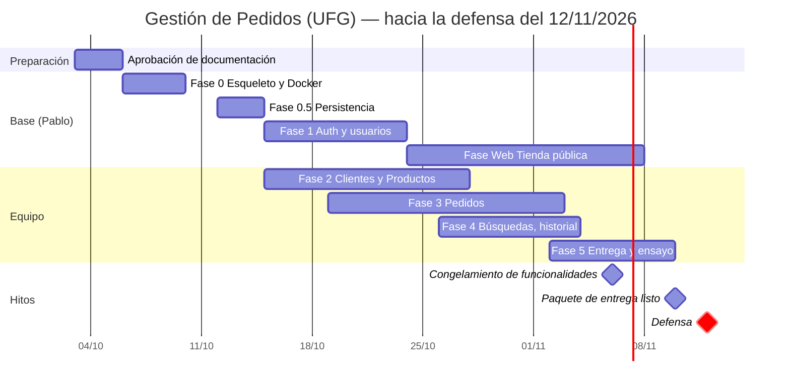

# 📋 Plan de Implementación - Gestión de Pedidos (UFG)

> Cada fase se cierra con sus pruebas y su spec actualizada; una fase sin pruebas no está terminada ([Testing.md](Especificaciones/Testing.md)). La **defensa es el jueves 12 de noviembre de 2026** (fecha asignada por el ingeniero); el cronograma se calcula hacia atrás desde ahí.

## 1. Estado Actual

| Elemento | Estado |
|---|---|
| Requerimientos oficiales y patrón de eventos | ✅ Analizados ([Analisis.md](Analisis.md), [PatronEventos.md](Especificaciones/PatronEventos.md)) |
| Documentación y specs de módulos | ✅ Completa |
| **Fase 0** — Esqueleto, Docker, interfaz y pruebas | ✅ Hecha (excepto validar el escritorio MAUI en Windows) |
| **Fase 0.5** — Persistencia: 11 tablas, migraciones, semillas, script SQL, respaldo | ✅ Hecha |
| **Fase 1** — Autenticación, usuarios, roles y permisos (API + Ui) | ✅ Hecha |
| Fases 2 a 5 (Clientes, Productos, Pedidos, búsquedas, historial, entrega) | 🕓 Pendientes: ver [Tareas.md](Equipo/Tareas.md) |

**Calidad actual**: 109 pruebas automáticas (unitarias, integración con SQL Server real en Docker, arquitectura) + 3 pruebas de extremo a extremo con Playwright. No hay CI/CD: se corre `./scripts/test-docker.sh` antes de subir cambios ([Testing.md §6](Especificaciones/Testing.md)).

## 2. Fases

### Fase 0 — Esqueleto, Docker, interfaz y pruebas ✅
- [x] Solución `.sln` (+ filtro `GestionPedidos.Linux.slnf` sin `Desktop`), `global.json` (SDK 8.0), `Directory.Build.props` (nullable, advertencias como errores, **XML docs obligatorios**), `Directory.Packages.props`, `.editorconfig`.
- [x] Proyectos por capa con las referencias de [Arquitectura.md §2](Arquitectura.md), verificadas por `Architecture.Tests`.
- [x] `docker-compose.yml` (`sqlserver` + `db-init` + `api` + `web`) con healthchecks, `.env.example`, Dockerfiles multi-etapa, puertos 4390–4392.
- [x] Scripts: `up.sh`, `down.sh`, `dotnet-docker.sh`, `ef-docker.sh`, `test-docker.sh`, `e2e-docker.sh`, `db-backup.sh`, `db-restore.sh`, `generar-script-sql.sh`.
- [x] `GET /health` y `/health/ready`; errores con Problem Details; *rate limiting* en login y registro.
- [x] Interfaz (`Ui`): shell con pestañas de documentos, tema, kit de componentes (propio, sin MudBlazor), `ApiClient`, sesión, avisos; hospedajes `Web` y `Desktop` (MAUI) que cargan la misma `Ui`.
- [x] Harness de pruebas con Testcontainers (SQL Server real) y Playwright para extremo a extremo.
- [x] **Escritorio compila y abre el login en Windows** (validado el 25/10/2026 en Windows 11 con SDK 8.0.427): exige además `dotnet workload install maui`, ya documentado ([PrimerosPasos.md §4.1](Equipo/PrimerosPasos.md#41-paso-a-paso-con-visual-studio-2022-o-2026)).
- [ ] **Confirmar a mano el flujo completo del escritorio** (iniciar sesión, abrir Usuarios e Integrantes, cerrar sesión, rechazo de un usuario Cliente) en los equipos de todos los integrantes.
- [ ] Probar el `.exe` publicado en un equipo del laboratorio (Windows y WebView2).

### Fase 0.5 — Persistencia base ✅
- [x] `GestionPedidosDbContext` con convenciones globales (decimales `(18,2)`, fechas UTC, longitudes, `RowVersion`, `CreadoEn/ActualizadoEn` automáticos).
- [x] Configuración de **las 11 tablas** y migración `CrearEsquemaInicial` ([BaseDatos.md §4](BaseDatos.md)), con restricciones `CHECK`, `UNIQUE` (incluidos los índices únicos filtrados) y FK.
- [x] Migración `AgregarBusquedaDePedidosYPermisosDeBD`: vista `vw_PedidosResumen`, procedimiento `usp_Pedidos_Buscar` y permisos del usuario de la aplicación (el historial queda inalterable).
- [x] `scripts/sql/init-usuarios.sql` (usuarios `pedidos_app` y `pedidos_migrator`).
- [x] Semillas: roles, 25 permisos, matriz, 14 departamentos y 262 distritos; administrador inicial al arrancar.
- [x] **Script SQL con todas las tablas**: [`scripts/sql/GestionPedidos_esquema.sql`](../scripts/sql/GestionPedidos_esquema.sql) (generado desde las migraciones; idempotente).
- [x] `db-backup.sh` y `db-restore.sh` con verificación de conteos ([RespaldoYEntrega.md](Especificaciones/RespaldoYEntrega.md)).

### Fase 1 — Autenticación, usuarios, roles y permisos ✅
- [x] Login con **JWT de 60 min** (sin *refresh tokens*), usuario activo comprobado en cada petición (caché 60 s), bloqueo tras 5 fallos, cambio de clave obligatorio y registro web de clientes con enlace por teléfono ([AutenticacionYPermisos.md](Especificaciones/AutenticacionYPermisos.md)).
- [x] CRUD de **Usuarios** con baja lógica, reglas del último administrador y concurrencia optimista; consulta de **Roles y permisos**.
- [x] Autorización por permisos en la API (política por cada permiso del catálogo).
- [x] `Ui`: login, cambio de contraseña, shell con **menú por permisos** y pestañas, módulo de Usuarios, **Integrantes**, cierre de sesión; funciona igual en web y escritorio.
- [x] Eventos `SesionIniciada`, `SesionCerrada`, `SesionPorExpirar`, `SesionExpirada`, `EntidadCambiada`, `DocumentoAbierto/Cerrado/Activado` ([PatronEventos.md](Especificaciones/PatronEventos.md)) y el historial como suscriptor.

> **Usuarios es el módulo de referencia**: para un módulo nuevo se copia su estructura ([PrimerosPasos.md §5](Equipo/PrimerosPasos.md)).

### Fase 2 — Clientes y Productos *(repartida entre el equipo)*
Módulos independientes entre sí; se trabajan en paralelo. Incluye los catálogos Departamentos/Ciudades dentro de Clientes. Specs: [Clientes.md](Especificaciones/Clientes.md), [Productos.md](Especificaciones/Productos.md).

### Fase 3 — Pedidos *(repartida)*
Depende de Clientes y Productos (consume sus contratos y el stock). Spec: [Pedidos.md](Especificaciones/Pedidos.md). Empieza por el dominio puro, que no necesita esperar a los otros módulos.

### Fase 4 — Búsquedas avanzadas, historial y notificaciones *(repartida)*
Búsquedas completas de [Busquedas.md](Especificaciones/Busquedas.md), [HistorialActividades.md](Especificaciones/HistorialActividades.md) y refresco/notificación entre ventanas.

### Fase Web — Tienda pública *(a cargo de Pablo, en paralelo desde el 24/10; se presenta el 12/11)*
Área `Tienda/` de la misma `Ui` (catálogo, registro, carrito, mis pedidos y perfil) y los endpoints públicos de la API ([PortalWeb.md](Especificaciones/PortalWeb.md), bloque W de [Tareas.md](Equipo/Tareas.md)). Arranca al cerrar la Fase 1.

### Fase 5 — Entrega y defensa *(todo el equipo)*
Datos de demostración, respaldo/restauración final, publicación del `.exe`, PDF de entrega y ensayo de la defensa ([RespaldoYEntrega.md](Especificaciones/RespaldoYEntrega.md)).

El desglose de tareas de las Fases 2 a 5 está en [Tareas.md](Equipo/Tareas.md); Pablo decide quién toma cada una.

## 3. Cronograma Propuesto

* Quedan **~5 semanas y media** hasta la defensa. Por eso las **Fases 2 y 3 arrancan el 15/10 en paralelo con la Fase 1**, con todo lo que no depende de autenticación (dominio, EF, casos de uso, DTOs, servicios de cliente); los permisos y el menú se conectan cuando termina la Fase 1 (~23/10).
* **Congelamiento de funcionalidades el 6/11**: del 6 al 10 solo se corrigen errores, se prueba la restauración, se arma el paquete de entrega y se ensaya la defensa.

## 4. Trabajo en Equipo

* **Ramas**: una por módulo o apartado (`feat/<modulo>-<tema>`, ej. `feat/clientes-pagina`), `fix/…`, `docs/…`; se integran a `main` por Pull Request con **una revisión** de otro integrante. **Sin CI/CD**: antes de abrir el PR quien lo escribe corre `./scripts/test-docker.sh` (y `./scripts/e2e-docker.sh` si tocó la interfaz) y lo anota en el PR.
* **Commits granulares**: uno por apartado revisable (entidad, configuración EF, caso de uso, endpoint, ViewModel, página…), con título y descripción; cada commit deja el repositorio compilando y con pruebas en verde. Formato: `tipo(modulo): resumen` (`feat(clientes): agregar caso de uso RegistrarCliente`).
* **Reparto (25/10/2026)**: los 3 integrantes se reparten **Clientes, Productos y Pedidos con su detalle**; Pablo lleva usuarios, roles y permisos, catálogos, historial, entrega y la web (con tres funcionalidades de cliente provisionales para el equipo). Detalle en [Tareas.md](Equipo/Tareas.md#reparto-del-equipo-acordado-el-25102026).
* **Un módulo = un dueño** de principio a fin (API + escritorio + pruebas + spec). Cada módulo vive en sus propias carpetas ([Estructura.md §2](Estructura.md)) para evitar conflictos.
* **Archivos compartidos** (modificar con cuidado y en PR pequeños): `DbContext`, `Program.cs`, `MainLayout` (menú), `Contracts`. Cada módulo se registra con un método de extensión propio (`AddClientes()`, `MapClientes()`) para que `Program.cs` solo cambie una línea.
* **Migraciones**: una a la vez ([BaseDatos.md §8](BaseDatos.md)). Avisar en el chat del equipo antes de generar una; si otra se integra primero, se rehace la propia.
* **Spec primero**: el PR de un módulo incluye su spec actualizada.
* **Uso de agentes de IA**: todos los integrantes trabajan con el mismo contrato ([AGENTS.md](../AGENTS.md), [PautasCodigoEventos.md](Equipo/PautasCodigoEventos.md)); el autor entiende y puede defender cada línea que sube. Cada PR se revisa contra la lista de verificación de [PautasCodigoEventos.md §10](Equipo/PautasCodigoEventos.md).
* **Definición de terminado**: [Principios.md §8](Principios.md).

## 5. Riesgos

| Riesgo | Mitigación |
|---|---|
| Código inconsistente por usar distintos agentes de IA | `AGENTS.md`, pautas con plantillas, módulo de referencia (Usuarios) y revisión por PR |
| MAUI Blazor Hybrid no se compila o depura bien en algún equipo | La `Ui` se desarrolla en el navegador (hospedaje web, Docker); el host `Desktop` es delgado; plan B: `BlazorWebView` dentro de Windows Forms/WPF ([Tecnologia.md §3.1](Tecnologia.md)) |
| Carga de Pablo (Fases 0–1 y la web a la vez) | La web arranca al cerrar la Fase 1 y se limita al alcance mínimo de [PortalWeb.md §1](Especificaciones/PortalWeb.md) |
| El servidor no tiene RAM para SQL Server | El despliegue en servidor queda pospuesto; todo corre y se defiende en local ([Infraestructura.md §4](Infraestructura.md)) |
| Defensa sin red | Todo corre en local con Docker Desktop; ensayo previo |
| Conflictos de migraciones | Regla de una a la vez |
| Plazo corto (defensa el 12/11) | Fases 2–3 en paralelo con la 1, Pedidos arranca con dominio puro, congelamiento el 6/11; si hace falta, se recortan las tareas marcadas como opcionales |
| SQL Server consume mucha RAM | `MSSQL_MEMORY_LIMIT_MB` en el compose |
| Un integrante no puede defender lo que no hizo | Revisiones cruzadas y sesión de ensayo en Fase 5 |
