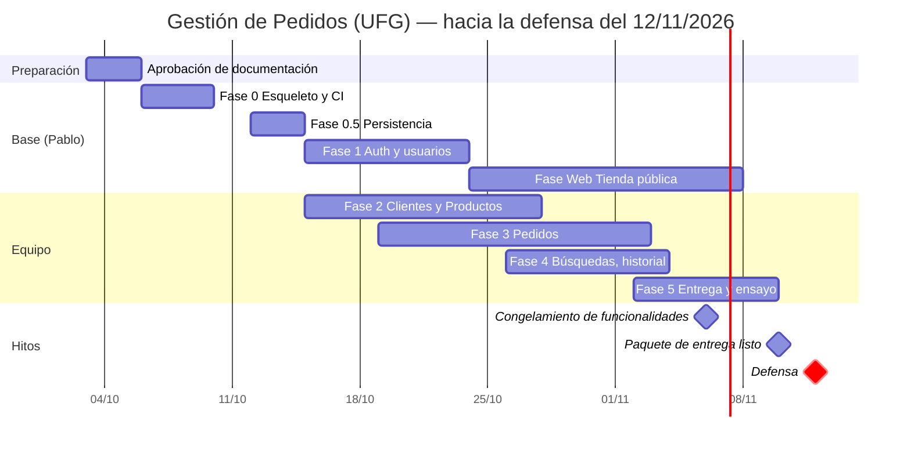

# 📋 Plan de Implementación - Gestión de Pedidos (UFG)

> Cada fase se cierra con sus pruebas y su spec actualizada; una fase sin pruebas no está terminada ([Testing.md](Especificaciones/Testing.md)). La **defensa es el jueves 12 de noviembre de 2026** (fecha asignada por el ingeniero); el cronograma se calcula hacia atrás desde ahí.

## 1. Estado Actual

| Elemento | Estado |
|---|---|
| Requerimientos oficiales | ✅ Recibidos y analizados ([Analisis.md](Analisis.md)) |
| Patrón de eventos | ✅ Delegados y eventos de C# ([PatronEventos.md](Especificaciones/PatronEventos.md)) |
| Documentación base y specs de módulos | 🟡 Borrador completo, pendiente de aprobación |
| Código | ⛔ Aún no iniciado |

## 2. Fases

### Fase 0 — Esqueleto, Docker y CI *(a cargo de Pablo, con asistente)*
- [ ] Solución `.sln` (el formato `.slnx` exige .NET 9+), `global.json` con el SDK **8.0**, `Directory.Build.props` (nullable, advertencias como errores, **XML docs activados**), `Directory.Packages.props`, `.editorconfig`.
- [ ] Proyectos vacíos por capa con las referencias de [Arquitectura.md §2](Arquitectura.md) y `Architecture.Tests` que las verifica.
- [ ] `docker-compose.yml` (`sqlserver` + `api`; `web` llega con la Fase Web), `docker-compose.dokploy.yml`, healthchecks, `.env.example`, Dockerfile multi-etapa.
- [ ] Scripts `scripts/*-docker.sh` para la API, la web, las migraciones y las pruebas (el host `Desktop` no se compila en Docker; ver la validación de MAUI más abajo).
- [ ] `GET /health` y `/health/ready`; manejo global de errores con Problem Details.
- [ ] Harness de pruebas: `AbstractIntegrationTest` con Testcontainers (SQL Server) + Respawn.
- [ ] Esqueleto de la interfaz: proyecto `Ui` (Razor Class Library) con `MainLayout` y pestañas de documentos, tema, kit de componentes (`Boton`, `CampoTexto`, `TablaDatos`, `Paginador`, `PaginaModulo`), `ApiClient` base e `ISesionAlmacen`; hospedajes `Web` (Blazor Web App) y `Desktop` (MAUI Blazor Hybrid) que cargan la misma `Ui`.
- [ ] **Validación de MAUI Blazor Hybrid con VS Code** en Windows: `dotnet workload install maui`, compilar, ejecutar y depurar el host `Desktop`; si no funciona sin Visual Studio, se documenta la excepción para ese único proyecto ([Tecnologia.md §3.1](Tecnologia.md)). Decidir si se usa MudBlazor y fijar su versión compatible con .NET 8.
- [ ] Configuración de **VS Code** compartida: `.vscode/extensions.json` (C# Dev Kit, .NET MAUI), `launch.json` y `tasks.json` para la API, la web y el escritorio.
- [ ] CI en GitHub Actions ([GuiaCI.md](Equipo/GuiaCI.md)) y `AGENTS.md`.
- **Hecho cuando**: `docker compose up` deja la API sana, `test-docker.sh` pasa en verde, el `.exe` de escritorio y la web abren el shell con la misma `Ui` y el CI está en verde.

### Fase 0.5 — Persistencia base *(Pablo, con asistente)*
- [ ] `GestionPedidosDbContext` con convenciones globales (decimales, longitudes, `RowVersion`, `CreadoEn/ActualizadoEn`).
- [ ] **Todas** las configuraciones de entidad y la migración `CrearEsquemaInicial` con las tablas de [BaseDatos.md §4](BaseDatos.md) (aunque sus módulos lleguen después).
- [ ] Procedimiento `usp_Pedidos_Buscar` y vista `vw_PedidosResumen` (migración propia).
- [ ] `scripts/sql/init-usuarios.sql` (usuarios `pedidos_app` y `pedidos_migrator`).
- [ ] Semillas obligatorias: roles (incluye `Cliente`), permisos, matriz, departamentos y ciudades desde `seed/el-salvador-geo.json`, administrador inicial.
- [ ] `db-backup.sh` y `db-restore.sh` con prueba de restauración ([RespaldoYEntrega.md](Especificaciones/RespaldoYEntrega.md)).
- **Hecho cuando**: la BD se crea desde cero con una migración, las pruebas de integración verifican restricciones (`CHECK`, `UNIQUE`, FK) y la restauración funciona.

### Fase 1 — Autenticación, usuarios, roles y permisos *(Pablo, con asistente)*
- [ ] Login con **JWT de 60 min** (sin *refresh tokens*), comprobación de usuario activo, bloqueo, cambio de clave obligatorio y registro web de clientes ([AutenticacionYPermisos.md](Especificaciones/AutenticacionYPermisos.md)).
- [ ] CRUD de **Usuarios** (con baja lógica) y consulta/gestión de **Roles y Permisos**.
- [ ] Política de autorización por permisos en la API.
- [ ] `Ui`: página de login, sesión (`SesionService`), shell con **menú según permisos** y pestañas, módulo de Usuarios, **Integrantes**, cierre de sesión; visibles en ambos hospedajes.
- [ ] Eventos `SesionIniciada`, `SesionCerrada`, `SesionPorExpirar` y `SesionExpirada` ([PatronEventos.md §5](Especificaciones/PatronEventos.md)).
- **Hecho cuando**: un administrador y un operador inician sesión y ven menús distintos, la API rechaza con `403` lo no permitido y todo tiene pruebas.

> Al cerrar la Fase 1 queda un **módulo completo de referencia** (Usuarios) que sirve de plantilla real para los demás.

### Fase 2 — Clientes y Productos *(repartida entre el equipo)*
Módulos independientes entre sí; se trabajan en paralelo. Incluye los catálogos Departamentos/Ciudades dentro de Clientes. Specs: [Clientes.md](Especificaciones/Clientes.md), [Productos.md](Especificaciones/Productos.md).

### Fase 3 — Pedidos *(repartida)*
Depende de Clientes y Productos (consume sus contratos y el stock). Spec: [Pedidos.md](Especificaciones/Pedidos.md). Empieza por el dominio puro, que no necesita esperar a los otros módulos.

### Fase 4 — Búsquedas avanzadas, historial y notificaciones *(repartida)*
Búsquedas completas de [Busquedas.md](Especificaciones/Busquedas.md), [HistorialActividades.md](Especificaciones/HistorialActividades.md) y refresco/notificación entre ventanas.

### Fase Web — Tienda pública *(a cargo de Pablo, en paralelo desde el 24/10; se presenta el 12/11)*
Área `Tienda/` de la misma `Ui` (catálogo, registro, carrito, mis pedidos y perfil) y los endpoints públicos de la API ([PortalWeb.md](Especificaciones/PortalWeb.md), bloque W de [Tareas.md](Equipo/Tareas.md)). Arranca al cerrar la Fase 1.

### Fase 5 — Entrega y defensa *(todo el equipo)*
Datos de demostración, respaldo/restauración final, publicación del `.exe`, PDF de entrega y ensayo de la defensa ([RespaldoYEntrega.md](Especificaciones/RespaldoYEntrega.md)).

El desglose de tareas de las Fases 2 a 5 está en [Tareas.md](Equipo/Tareas.md); Pablo decide quién toma cada una.

## 3. Cronograma Propuesto

* Quedan **~5 semanas y media** hasta la defensa. Por eso las **Fases 2 y 3 arrancan el 15/10 en paralelo con la Fase 1**, con todo lo que no depende de autenticación (dominio, EF, casos de uso, DTOs, servicios de cliente); los permisos y el menú se conectan cuando termina la Fase 1 (~23/10).
* **Congelamiento de funcionalidades el 6/11**: del 6 al 10 solo se corrigen errores, se prueba la restauración, se arma el paquete de entrega y se ensaya la defensa.

## 4. Trabajo en Equipo

* **Ramas**: `main` protegida (solo por Pull Request con CI en verde y **una revisión** de otro integrante). Ramas `feat/<modulo>-<tema>` (ej. `feat/clientes-pagina`), `fix/…`, `docs/…`.
* **Commits granulares**: uno por apartado revisable (entidad, configuración EF, caso de uso, endpoint, ViewModel, página…), con título y descripción; cada commit deja el repositorio compilando y con pruebas en verde. Formato: `tipo(modulo): resumen` (`feat(clientes): agregar caso de uso RegistrarCliente`).
* **Un módulo = un dueño** de principio a fin (API + escritorio + pruebas + spec). Cada módulo vive en sus propias carpetas ([Estructura.md §2](Estructura.md)) para evitar conflictos.
* **Archivos compartidos** (modificar con cuidado y en PR pequeños): `DbContext`, `Program.cs`, `MainLayout` (menú), `Contracts`. Cada módulo se registra con un método de extensión propio (`AddClientes()`, `MapClientes()`) para que `Program.cs` solo cambie una línea.
* **Migraciones**: una a la vez ([BaseDatos.md §8](BaseDatos.md)). Avisar en el chat del equipo antes de generar una; si otra se integra primero, se rehace la propia.
* **Spec primero**: el PR de un módulo incluye su spec actualizada.
* **Uso de agentes de IA**: todos los integrantes trabajan con el mismo contrato ([AGENTS.md](../AGENTS.md), [PautasCodigoEventos.md](Equipo/PautasCodigoEventos.md)); el autor entiende y puede defender cada línea que sube. Cada PR se revisa contra la lista de verificación de [PautasCodigoEventos.md §10](Equipo/PautasCodigoEventos.md).
* **Definición de terminado**: [Principios.md §8](Principios.md).

## 5. Riesgos

| Riesgo | Mitigación |
|---|---|
| Código inconsistente por usar distintos agentes de IA | `AGENTS.md`, pautas con plantillas, módulo de referencia (Usuarios) y revisión por PR |
| MAUI Blazor Hybrid no se compila o depura bien en algún equipo | La `Ui` se desarrolla en el navegador (hospedaje web, Docker); el host `Desktop` es delgado; plan B: `BlazorWebView` dentro de Windows Forms/WPF ([Tecnologia.md §3.1](Tecnologia.md)) |
| Carga de Pablo (Fases 0–1 y la web a la vez) | La web arranca al cerrar la Fase 1 y se limita al alcance mínimo de [PortalWeb.md §1](Especificaciones/PortalWeb.md) |
| El servidor no tiene RAM para SQL Server | El despliegue en servidor queda pospuesto; todo corre y se defiende en local ([Infraestructura.md §4](Infraestructura.md)) |
| Defensa sin red | Todo corre en local con Docker Desktop; ensayo previo |
| Conflictos de migraciones | Regla de una a la vez |
| Plazo corto (defensa el 12/11) | Fases 2–3 en paralelo con la 1, Pedidos arranca con dominio puro, congelamiento el 6/11; si hace falta, se recortan las tareas marcadas como opcionales |
| SQL Server consume mucha RAM | `MSSQL_MEMORY_LIMIT_MB` en el compose |
| Un integrante no puede defender lo que no hizo | Revisiones cruzadas y sesión de ensayo en Fase 5 |
